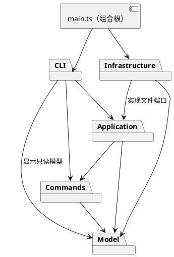

# Lab1 Phase 1 设计与实现记录

## 架构方案

### 模块划分

| 目录 | 职责 |
| --- | --- |
| `src/model/` | Shape 类层次、几何和样式规则、Composite、文档树、图形工厂；不访问文件和终端 |
| `src/commands/` | 每条编辑命令的对象、执行与撤销历史；以文档快照保证失败原子性 |
| `src/application/` | 当前文档会话、读写端口、历史屏障、面向 CLI 的应用入口 |
| `src/infrastructure/` | SVG XML 编解码和文件读写端口实现 |
| `src/cli/` | 引号词法分析、命令注册分发、tree/show 格式化、REPL |
| `src/main.ts` | 组合根；创建具体依赖并启动程序 |
| `test/`、`examples/` | 模型与会话验收、可回放的流程图示例 |

### 设计模式的选择

- **Command**：每条编辑命令是对象，历史管理器把成功编辑作为一个撤销单元；undo/redo 还原执行前后的深拷贝文档。采用快照会增加内存开销，但能完整恢复分组的父节点、顺序、文本和几何，适合本实验的小文档。
- **Composite**：Group 与叶子均继承 Shape，共享 move、scale、set 和 clone 接口；容器递归执行几何操作，无需在调用方区分标签。
- **Factory**：ShapeFactory 负责六种内置类型的构造，外部 SVG 也复用工厂。类型名分派集中在这一处。
- **依赖倒置**：应用只依赖文件端口；文件系统和 XML 实现位于 infrastructure，单元测试可替换为内存端口。

按名字分派只保留两处：CLI 的命令注册表和 ShapeFactory 的图形注册表。按实验约定把它们标注为后续插件注册阶段的待重构点；本阶段不实现 `box` 和插件加载。

### 依赖方向规则

1. model 只依赖标准语言能力和同层模型，不导入 CLI、应用、命令或文件系统。
2. commands 仅依赖 model；历史只保存领域状态，不承担终端和 IO。
3. application 依赖 model、commands 和其自身定义的 IO 端口。
4. infrastructure 依赖 model 与 application 的端口，禁止反向依赖。
5. cli 依赖 application、commands 与只读 model；不直接使用文件系统或 XML 库。
6. main 作为组合根可连接所有外层模块。测试可跨模块，但生产模块不得依赖测试。

### 变化点假设

| 变化点 | 当前决策 |
| --- | --- |
| 增加图形或插件 | 通过 Shape 多态和集中工厂构造；暂不设计动态插件生命周期 |
| 加入 GUI 或 agent 入口 | 编辑命令和会话不依赖 REPL；可由新适配器复用 |
| 替换 SVG/存储后端 | IO 通过端口注入；XML 细节不进入模型 |
| 大型文档的撤销内存 | 当前整文档快照易验证；未来可替换为命令增量，不提前优化 |
| 更复杂外部 SVG | Phase 1 仅支持六种内置元素和白名单属性；无法无损表达的输入明确拒绝，避免静默丢失 |

### 语义决策

- `front` 放到同级末尾（SVG 后绘制的图形覆盖先绘制的图形），`back` 放到同级开头。
- 跨父容器分组按原文档前序/绘制顺序收集子树；新组占第一个成员在其原父级的位置，不按命令参数重排。
- `ungroup` 只允许非根级的普通容器，子节点依次替换原组位置。
- `canvas` 查询不阻断历史；成功的 init/read/save 和 canvas 修改尺寸清空历史并设置 IO 屏障，失败不改变状态。
- 导入不静默忽略不能表达的 transform、额外属性或未知元素；后续需要完整 SVG 支持时再扩展模型。

## 过程记录

1. 检查工作区，发现只有实验要求；检查目标仓库确认为空。在当前目录初始化 main，保留原始要求。
2. 将实现拆成模型、命令/CLI、SVG 适配器、最终验收等小提交；优先确定失败原子性和模块依赖，再逐步落地。

## 一致性自查

实现完成后填写目录对照、依赖抽查和修订情况。

## 质量保证手段

计划使用严格 TypeScript 类型检查、领域模型测试、CLI 会话测试和 SVG 往返测试。测试重点是命令失败不变状态、祖先关系、层级/绘制顺序、IO 屏障和自动补 id 冲突处理。最终记录实际执行结果。
