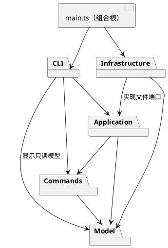

# Lab1 Phase 1 设计与实现记录

## 架构方案

### 模块划分

| 目录 | 职责 |
| --- | --- |
| `src/model/` | Shape 类层次、几何和样式规则、Composite、文档树、图形工厂；不访问文件和终端 |
| `src/commands/` | 每条编辑命令的对象、执行与撤销历史；以文档快照保证失败原子性 |
| `src/application/` | 当前文档会话、读写端口、历史屏障、面向 CLI 的应用入口 |
| `src/infrastructure/` | SVG XML 编解码和文件读写端口实现 |
| `src/cli/` | 引号词法分析、命令注册分发、tree/show 格式化、REPL |
| `src/main.ts` | 组合根；创建具体依赖并启动程序 |
| `test/`、`examples/` | 模型与会话验收、可回放的流程图示例 |

### 设计模式的选择

- **Command**：每条编辑命令是对象，历史管理器把成功编辑作为一个撤销单元；undo/redo 还原执行前后的深拷贝文档。采用快照会增加内存开销，但能完整恢复分组的父节点、顺序、文本和几何，适合本实验的小文档。
- **Composite**：Group 与叶子均继承 Shape，共享 move、scale、set 和 clone 接口；容器递归执行几何操作，无需在调用方区分标签。
- **Factory**：ShapeFactory 负责六种内置类型的构造，外部 SVG 也复用工厂。类型名分派集中在这一处。
- **依赖倒置**：应用只依赖文件端口；文件系统和 XML 实现位于 infrastructure，单元测试可替换为内存端口。

按名字分派只保留两处：CLI 的命令注册表和 ShapeFactory 的图形注册表。按实验约定把它们标注为后续插件注册阶段的待重构点；本阶段不实现 `box` 和插件加载。

### 依赖方向规则

1. model 只依赖标准语言能力和同层模型，不导入 CLI、应用、命令或文件系统。
2. commands 仅依赖 model；历史只保存领域状态，不承担终端和 IO。
3. application 依赖 model、commands 和其自身定义的 IO 端口。
4. infrastructure 依赖 model 与 application 的端口，禁止反向依赖。
5. cli 依赖 application、commands 与只读 model；不直接使用文件系统或 XML 库。
6. main 作为组合根可连接所有外层模块。测试可跨模块，但生产模块不得依赖测试。

### 变化点假设

| 变化点 | 当前决策 |
| --- | --- |
| 增加图形或插件 | 通过 Shape 多态和集中工厂构造；暂不设计动态插件生命周期 |
| 加入 GUI 或 agent 入口 | 编辑命令和会话不依赖 REPL；可由新适配器复用 |
| 替换 SVG/存储后端 | IO 通过端口注入；XML 细节不进入模型 |
| 大型文档的撤销内存 | 当前整文档快照易验证；未来可替换为命令增量，不提前优化 |
| 更复杂外部 SVG | Phase 1 仅支持六种内置元素和白名单属性；无法无损表达的输入明确拒绝，避免静默丢失 |

### 语义决策

- `front` 放到同级末尾（SVG 后绘制的图形覆盖先绘制的图形），`back` 放到同级开头。
- 跨父容器分组按原文档前序/绘制顺序收集子树；新组占第一个成员在其原父级的位置，不按命令参数重排。
- `ungroup` 只允许非根级的普通容器，子节点依次替换原组位置。
- `canvas` 查询不阻断历史；成功的 init/read/save 和 canvas 修改尺寸清空历史并设置 IO 屏障，失败不改变状态。
- 导入不静默忽略不能表达的 transform、额外属性或未知元素；后续需要完整 SVG 支持时再扩展模型。

## 过程记录

1. 检查工作区，发现只有实验要求；检查目标仓库确认为空。在当前目录初始化 main，保留原始要求。
2. 先提交工程与方案，再分别提交 Shape/Composite、文档树与工厂、命令历史、CLI、SVG 适配器、示例验收和最终文档。模型、适配器和会话验收由不同 AI 子任务并行实现或审查，主任务核对接口、测试结果和提交边界。
3. 审查跨父容器分组时，实验未规定新组的父级位置，因此明确选择“文档顺序第一个成员的原槽位”。测试故意倒序传参，并检查 undo 恢复两个原父节点与原绘制顺序。
4. 审查数字解析，发现 JavaScript `Number()` 会接受 `0x10`，与 SVG 数字语法不一致；改为十进制/科学计数法校验。随后检查 viewBox，补充拒绝十六进制、连续逗号和空分量的回归测试。
5. 最初容器变换的预检反复克隆整个子树，深层嵌套会造成不必要的重复工作；改成只克隆叶子预检，并加入 50 层嵌套用例。执行阶段仍通过 Composite 递归。
6. I/O 在异步操作成功后才发布当前文档和历史屏障。错误路径测试验证读失败、写失败、无效画布尺寸不改变文档、保存路径及待重做命令。
7. 用真实 CLI 子进程回放含文件保存/读入、中文特殊字符、错误后继续执行、quit 的脚本，核对输出及磁盘内容；另外回放讲义流程图生成可直接预览的 SVG。独立审查还回放了 2004 条命令（含延迟保存），未发现异步读行丢失。

## 一致性自查

1. **模块划分一致**：实际生产目录为 model、commands、application、infrastructure、cli，加 main 组合根，与方案一致。文件名与类名一致；SvgRepository 文件定义端口和只读返回类型，没有额外类。
2. **依赖方向一致**：以 `rg '^import ' src` 检查全部静态导入。model 仅导入同目录模型；commands 仅导入 model 和同层历史对象；application 导入模型、命令和自有端口；infrastructure 导入模型与端口；cli 导入应用、命令、模型及 Node 终端流；main 装配具体 IO 实现。文件系统和 XML 库导入只出现在 infrastructure。
3. **模式落地**：CommandRouter 创建具体 EditCommand，EditorSession 调用 CommandHistory；HistoryEntry 保存命令和前后文档快照并执行 undo/redo。Group 与叶子共用 Shape 接口。没有散落的标签 switch；命令与类型注册表仍是标注的后续插件扩展点。
4. **修订与边界**：无目录架构偏离；分组位置、严格数字语法和外部 SVG 子集是已记录的语义细化。并发入口串行化留待 GUI/agent 阶段，当前 REPL 逐条 await，不存在同会话并发编辑。

## 质量保证手段

环境：Node.js 20.20.2；安装依赖使用 package-lock.json，`npm ci` 可重现。

`npm run check` 依次执行严格 TypeScript 检查、自动测试、编译。共 35 项测试：9 项模型、14 项会话、11 项 SVG/文件、1 项真实 CLI 子进程。全部通过。真实文件测试使用临时目录并清理，覆盖原子保存后的无残留文件和失败后的旧状态保留。

覆盖范围包括六类型与 in 子句、双引号/空字符串/中文、全几何属性变换、组样式继承、全局唯一 id、分组/解组/归属循环、同级 z-order、子树删除及恢复、撤销分支清理、成功 IO 屏障、失败保留 redo、自动 id 预占冲突、XML 转义与严格解析，以及讲义流程图。

手工/集成验收执行 `npm run cli < examples/flowchart.txt`，生成 8 元素 SVG；编译入口使用 `node dist/src/main.js` 回放导入和显示命令。支持范围之外的 SVG 特性显式拒绝，测试不宣称覆盖完整 SVG 标准。
